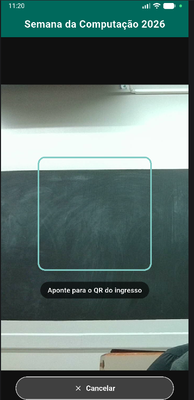

# 🎟️ Semana da Computação 2026 — App de Check-in de Evento

Aplicativo mobile desenvolvido em **Flutter** para a atividade avaliativa **AP2** da disciplina de **Desenvolvimento Multiplataformas** (9º Semestre — Curso de Ciência da Computação / Informática — ULBRA).

O aplicativo possibilita a emissão digital de ingressos com QR Code, leitura dinâmica em tempo real utilizando a câmera do dispositivo móvel, validação instantânea de credenciais e controle seguro da lista de presença com prevenção contra check-ins duplicados.

---

## 👥 Integrantes

* **Gustavo Daitx**
* **Tiago Porto**

---

## 📱 Telas do Aplicativo

Abaixo estão as capturas das principais telas e fluxos implementados na aplicação:

| 1. Ingresso Gerado | 2. Leitura com Câmera | 3. Check-in Confirmado |
| :---: | :---: | :---: |
|  |  |  |
| *Card oficial com dados do participante e QR Code gerado* | *Scanner com moldura visual e leitura única* | *Validação em verde e participante adicionado à lista de presença* |

---

## 🛠️ Tecnologias Obrigatórias e Bibliotecas

* **[Flutter](https://flutter.dev/)** (SDK 3.47+) & **Dart** (3.13+)
* **Material Design 3**: Identidade visual personalizada em tons de verde-petróleo (`#00695C`)
* **[qr_flutter](https://pub.dev/packages/qr_flutter) (^4.1.0)**: Renderização vetorial do QR Code na tela
* **[mobile_scanner](https://pub.dev/packages/mobile_scanner) (^5.0.0)**: Captura e decodificação via câmera em tempo real

---

## ⚙️ Funcionalidades e Regras de Negócio

* **R1 — Página Principal (`StatefulWidget`)**:
  * AppBar temática: *"Semana da Computação 2026"*.
  * Interface única e rolável (`SingleChildScrollView`) adaptada a qualquer resolução.

* **R2 — Formulário e Geração do Ingresso**:
  * Campos para **Nome do participante** e **E-mail** controlados por `TextEditingController` com descarte no `dispose()`.
  * Botão **Gerar ingresso** desabilitado dinamicamente enquanto o nome estiver vazio ou contiver apenas espaços.
  * O e-mail é opcional; o ingresso pode ser emitido apenas com o nome preenchido.

* **R3 — Formato Padronizado do QR Code**:
  * Estrutura rigorosa: `CHECKIN|nome|e-mail` (ex: `CHECKIN|Ana Souza|ana@email.com`).

* **R4 & R6 — Leitura Única e Navegação Condicional**:
  * Ao pressionar **Ler ingresso**, o corpo da tela é substituído temporariamente pela interface da câmera (`_lendoQrCode ? _construirTelaScanner() : _construirTelaPrincipal()`).
  * Moldura visual de enquadramento com instrução *"Aponte para o QR do ingresso"*.
  * Controle com `_processandoQr` que encerra a câmera imediatamente após a primeira leitura, prevenindo leituras em loop.
  * Botão **Cancelar** que retorna à tela inicial sem alterar a lista de presença nem gerar resultados indevidos.

* **R5 — Permissões de Câmera**:
  * Android: `android.permission.CAMERA` configurada no `AndroidManifest.xml`.
  * iOS: `NSCameraUsageDescription` declarada no `Info.plist`.

* **R7 — Validação do Ingresso (3 Resultados Exclusivos)**:
  1. **✔ Check-in confirmado** (Verde): Ingresso válido e participante ainda não registrado.
  2. **⚠ Já fez check-in** (Laranja/Amarelo): Ingresso válido, mas participante já consta na lista de presença (verificação *case-insensitive* e imune a espaços extras).
  3. **✖ QR inválido** (Vermelho): Links, URLs externas, textos avulsos ou códigos com separadores incorretos.

* **R8 — Lista de Presença**:
  * Título com contador dinâmico: `Presentes (N)`.
  * Construção com `Column`, `Text` e ícones de confirmação conforme o enunciado.
  * Preservação da grafia original dos nomes cadastrados.

---

## 🧪 Testes Automatizados

O projeto inclui suíte de testes de interface e regras de negócio em `test/widget_test.dart`, cobrindo todos os cenários da especificação (A, B, C, D, E, F e H):

```bash
# Executar todos os testes
flutter test
```

---

## 🚀 Como Executar o Projeto

1. **Clonar ou abrir o repositório** na pasta do projeto:
   ```bash
   cd AP2
   ```

2. **Instalar as dependências do Flutter**:
   ```bash
   flutter pub get
   ```

3. **Verificar a integridade do código**:
   ```bash
   flutter analyze
   ```

4. **Executar no dispositivo móvel ou emulador**:
   ```bash
   flutter run
   ```
